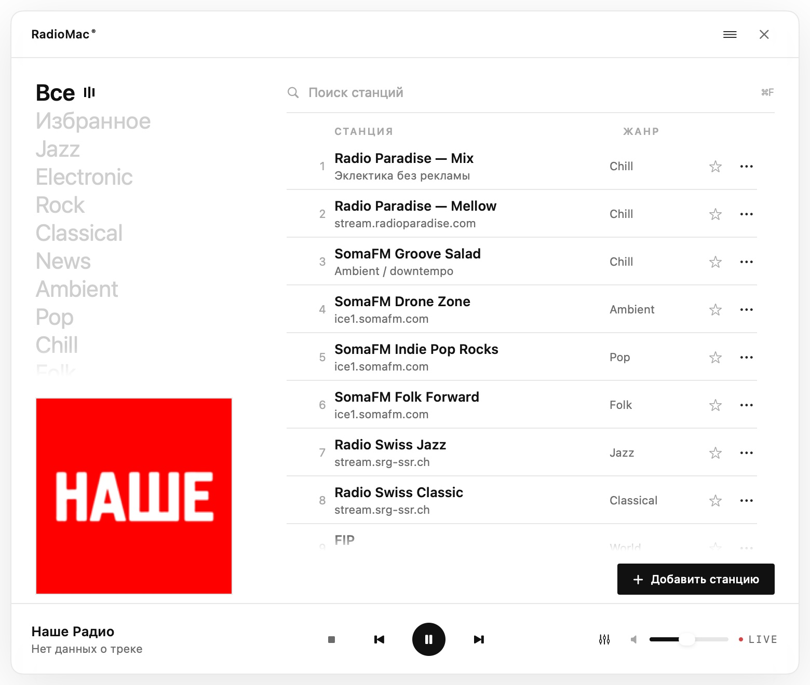
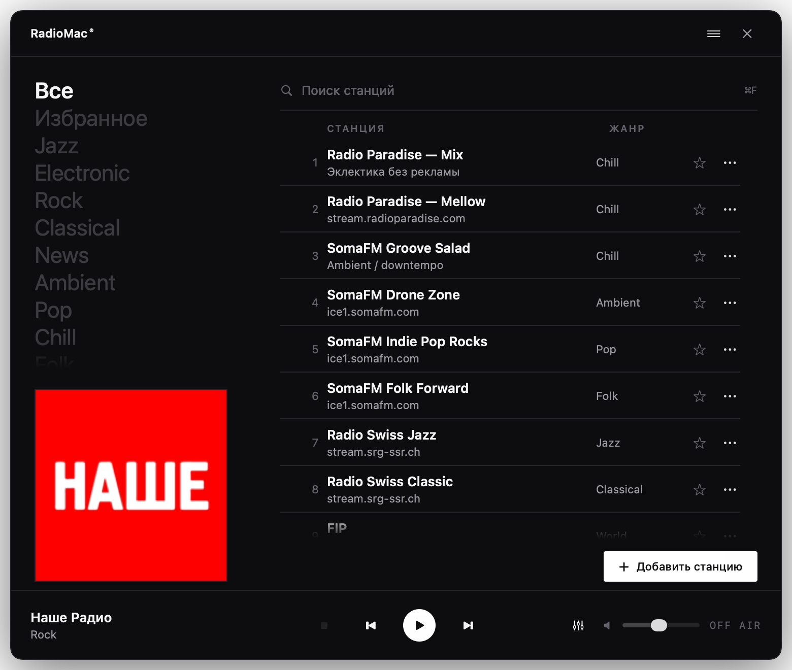
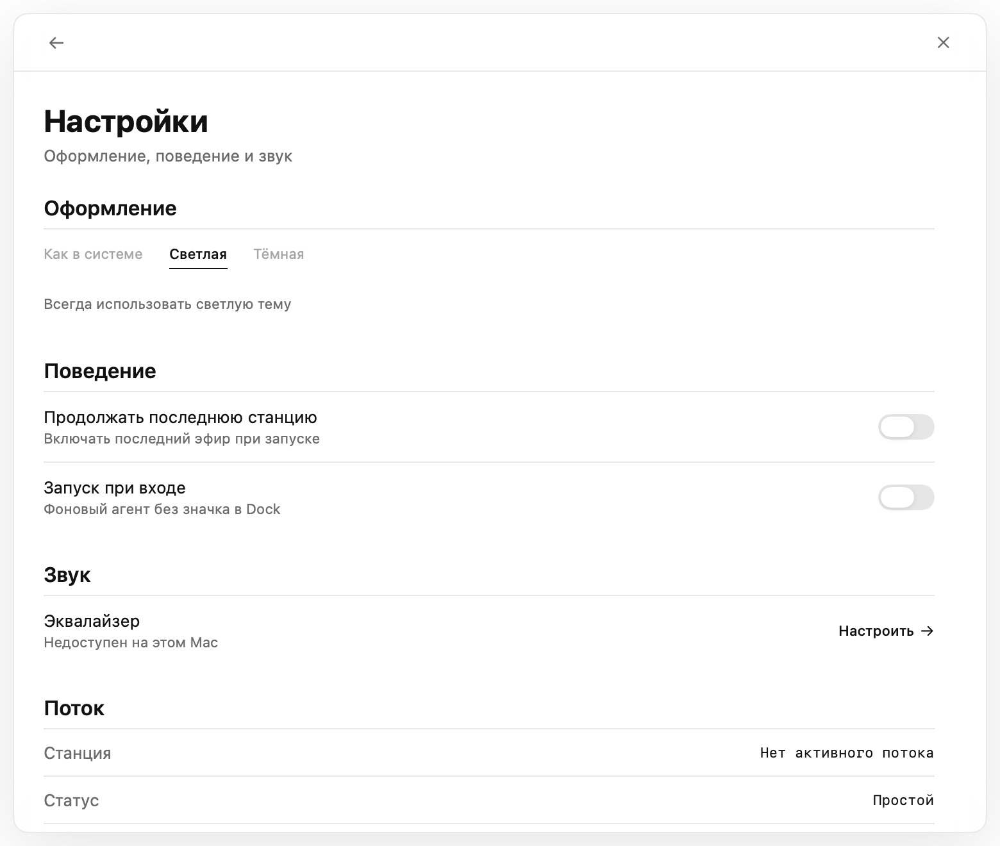
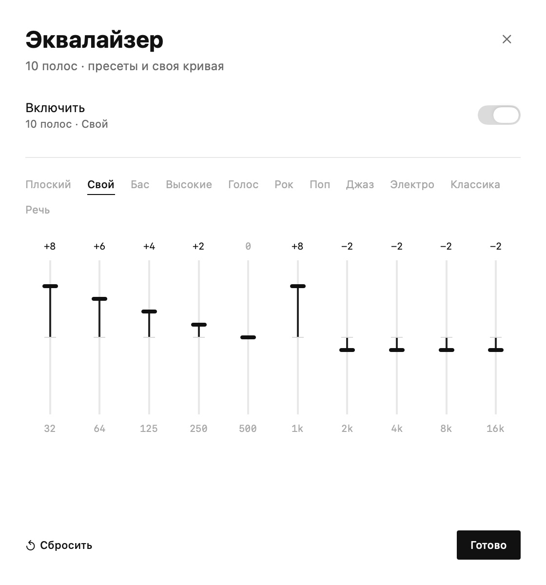
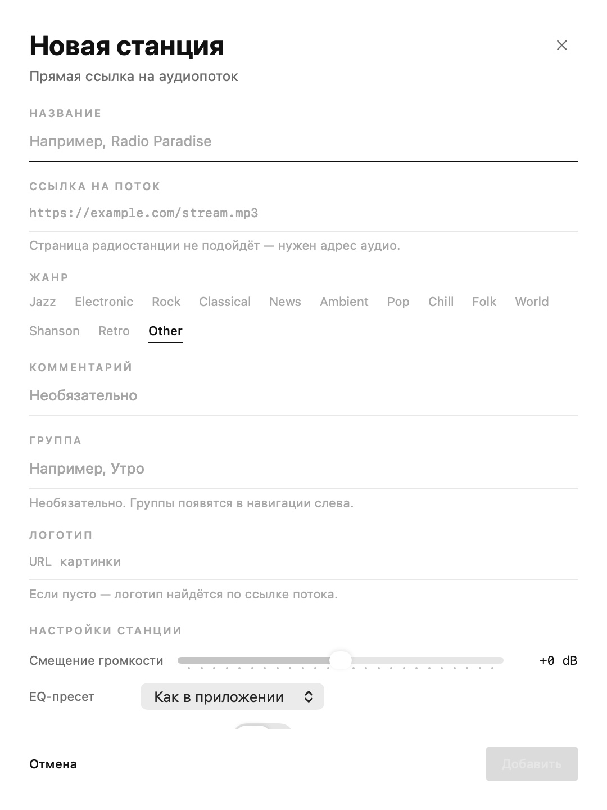
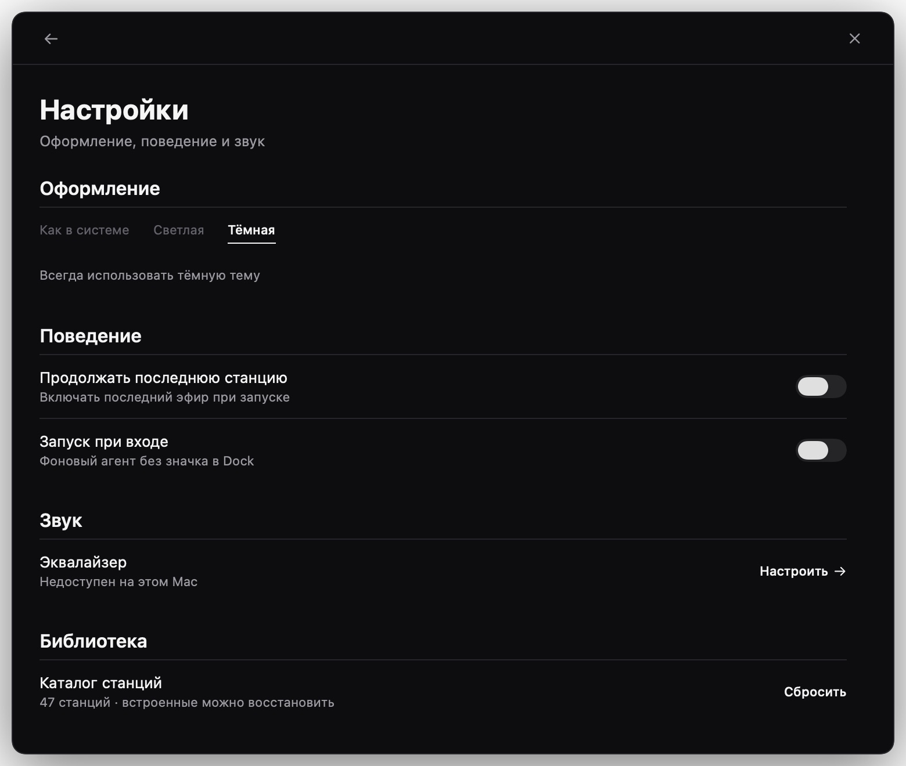
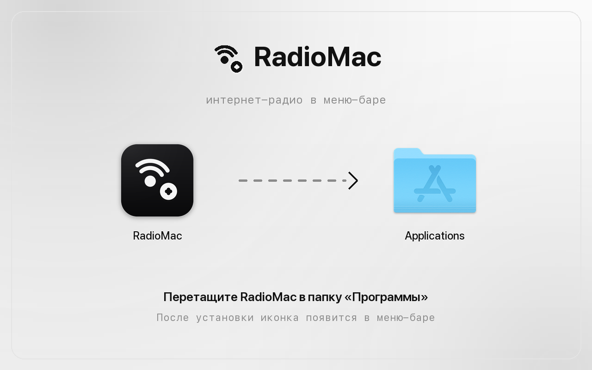

# RadioMac

Плеер интернет-радио для macOS, который живёт в меню-баре: без иконки в Dock, с эфиром,
который продолжается после закрытия окна. Написан на **Swift / SwiftUI + AppKit** поверх
аудиодвижка [BASS](https://www.un4seen.com/).

Интерфейс — светлый редакционный минимализм: бумажный фон, одна краска (чернила), крупная
типографика и таблица станций. Вдохновлено шотом
[Office Radio app](https://dribbble.com/shots/19641552-Office-Radio-app) Марко Колича
([PROTOTYP](https://dribbble.com/prototyp)); вёрстка, иконки и графика — свои.

[](https://github.com/fso13/RadioApple/actions/workflows/ci.yml)
[](https://github.com/fso13/RadioApple/actions/workflows/security.yml)
[](https://github.com/fso13/RadioApple/actions/workflows/pages.yml)

Сайт: [fso13.github.io/RadioApple](https://fso13.github.io/RadioApple/) ·
[Вики](https://github.com/fso13/RadioApple/wiki) ·
[Планы развития](ROADMAP.md) ·
[Релизы](https://github.com/fso13/RadioApple/releases)

| Главный экран | Тёмная тема |
| --- | --- |
|  |  |

| Настройки | Эквалайзер | Новая станция |
| --- | --- | --- |
|  |  |  |

## Две реализации в репозитории

| | Нативная (актуальная) | Flutter (предыдущая) |
| --- | --- | --- |
| Исходники | `RadioMac/`, `RadioMac.xcodeproj` | `lib/`, `macos/`, `pubspec.yaml` |
| Запуск | Xcode → `RadioMac` или `xcodebuild` | `flutter run -d macos` |
| UI | SwiftUI + AppKit (`NSStatusItem`, `NSPanel`) | Flutter Material |
| Движок | тот же BASS (`ThirdParty/BASS`) | тот же BASS |

Flutter-версия оставлена как есть. Нативное приложение использует тот же bundle id
`com.fso13.radioMac`, поэтому при первом запуске **подхватывает данные Flutter-версии**:
станции, избранное, громкость, последнюю станцию, пресет эквалайзера и тему.

## Требования

- macOS 14 (Sonoma) или новее
- Xcode 16.4+ (Swift 6 language mode; проверено на Xcode 27 / Swift 6.4)
- Apple Silicon или Intel: `libbass.dylib` и `libbass_fx.dylib` универсальные,
  `libbass_aac.dylib` — только x86_64 (см. «Ограничения»)

## Сборка и запуск

```bash
open RadioMac.xcodeproj    # схема RadioMac → Run (⌘R)

xcodebuild -project RadioMac.xcodeproj -scheme RadioMac -configuration Debug \
           -derivedDataPath .build/DerivedData build
open .build/DerivedData/Build/Products/Debug/RadioMac.app
```

Сборка подписана ad-hoc (`CODE_SIGN_IDENTITY = "-"`), для локального запуска этого достаточно.
Для распространения задайте свою команду в *Signing & Capabilities*.

Тесты (18 XCTest-кейсов, host-приложение):

```bash
xcodebuild test -project RadioMac.xcodeproj -scheme RadioMac \
                -configuration Debug -derivedDataPath .build/DerivedData
```

## Дизайн

- **Одна краска.** Интерфейс монохромный: чернила (#111 / #F5F5F5), бумага, серые уровни.
  Цвет приходит только из обложек станций и красной точки LIVE.
- **Типографика как иерархия.** SF Pro, крупные жанры слева (22 pt), таблица 13/11 pt,
  заголовки страниц 24–30 pt, подписи-надзаголовки 9.5 pt с трекингом.
- **Линии вместо карточек.** Хайрлайны 1 px задают структуру; радиусы 2–4 pt,
  у окна — 12 pt.
- **Классическая раскладка:** навигация по жанрам и обложка слева, таблица станций справа,
  транспорт на всю ширину снизу.
- **Тёмная тема** — инверсия той же системы (белые чернила, чёрная бумага), а не отдельный дизайн.

| Светлая тема | Тёмная тема |
| --- | --- |
|  |  |

## Возможности

- **Фирменный установщик**: окно с перетаскиванием, иконка тома и иконка приложения.
- **Меню-бар**: левый клик — показать/скрыть окно, правый — меню
  (играть/пауза, стоп, показать, настройки, завершить). Тултип показывает станцию и трек.
- **Окно 780×660** без рамки: своя «страница», перетаскивание за шапку, Esc или × скрывают
  окно, эфир продолжается.
- **Навигация по жанрам**: крупные слова слева, активный жанр с эквалайзер-индикатором,
  «Все» и «Избранное». Обложка текущей станции/трека — рядом.
- **Таблица станций**: номер, название и подпись, жанр, избранное, меню ⋮ и контекстное меню;
  поиск (⌘F) с подчёркиванием, счётчик в шапке, кнопка «Добавить станцию».
- **Группы и порядок**: необязательная группа в редакторе станции, фильтр групп в навигации
  и перетаскивание строк в режиме «Все», чтобы изменить порядок.
- **Диагностика потока**: кодек, битрейт, частота, каналы, буфер и сервер в настройках;
  кнопка «Скопировать диагностику» для issue.
- **Будильник-радио**: дни недели, выбор станции, плавное нарастание громкости
  и локальное уведомление.
- **Диагностика**: opt-in локальный журнал, обнаружение аварийных завершений,
  просмотр, копирование и очистка; без отправки данных.
- **Swift 6**: язык проекта, strict concurrency complete и warnings as errors.
- **Транспорт**: пауза/играть, стоп, **переключение на предыдущую/следующую станцию** в текущей
  выборке, громкость, эквалайзер, LIVE. Если ничего не выбрано, Play включает первую станцию.
- **Метаданные трека**: ICY-теги, Icecast `status-json.xsl`, API SomaFM и Radio Paradise,
  обложка из iTunes; заголовок и обложка уходят в Control Center (`MPNowPlayingInfoCenter`)
  вместе с командами play/pause.
- **Логотипы станций**: Radio Browser → сайт из ICY → favicon домена, кэш в памяти.
- **Эквалайзер**: 10 полос, пресеты, своя кривая, сохранение в `UserDefaults`.
- **Тема**: системная / светлая / тёмная.
- **Автозапуск**: `SMAppService.mainApp` (macOS 13+).
- **Прочее**: продолжение последней станции, восстановление каталога, встроенная документация,
  тосты, версия/сборка, корректные состояния загрузки и ошибок.

### Горячие клавиши

| Клавиши | Действие |
| --- | --- |
| `Esc` | убрать фокус из поиска, иначе скрыть окно |
| `Space` | пауза / продолжить |
| `↑` `↓` | двигать выделение |
| `Return` | играть выделенную станцию |
| `1`…`9` | сразу включить станцию из списка |
| `⌘F` | фокус в поиск |
| `⌘N` | новая станция |

## Установка: лаунчер, DMG и PKG

| Что | Где | Как использовать |
| --- | --- | --- |
| **Сайт** | [fso13.github.io/RadioApple](https://fso13.github.io/RadioApple/) | кнопка «Скачать» ведёт на последний релиз |
| **Homebrew** | `brew install --cask fso13/tap/radiomac` | после `brew tap fso13/tap` и `brew trust fso13/tap` |
| **Образ** | `dist/RadioMac-1.0.1.dmg` | открыть и перетащить `RadioMac` в `Applications` |
| **Установщик** | `dist/RadioMac-1.0.1.pkg` | двойной клик → «Продолжить» → «Установить» |
| Лаунчер | `Install RadioMac.command` | для локальной сборки: собрать, поставить в `/Applications`, запустить |
| Контрольные суммы | `dist/SHA256SUMS.txt` | `shasum -a 256 -c SHA256SUMS.txt` |



Образ открывается окном с перетаскиванием: тёмная иконка приложения слева, папка «Программы»
справа, подсказка и стрелка на фоне. Иконки расставлены по фону (170 и 470 pt), у тома своя
иконка, окно без панелей и сайдбара. Данные при обновлении сохраняются — bundle id не меняется.

### Homebrew

```bash
brew tap fso13/tap
brew trust fso13/tap               # Homebrew 7+
brew install --cask radiomac
```

Cask ставит последний стабильный релиз из
[`fso13/homebrew-tap`](https://github.com/fso13/homebrew-tap); Release workflow
обновляет `Casks/radiomac.rb` после публикации. Если Gatekeeper блокирует
ad-hoc сборку, используйте `brew install --cask --no-quarantine radiomac`
или разрешите запуск в System Settings → Privacy & Security.

```bash
scripts/install.sh                  # сборка + установка в /Applications + запуск
scripts/install.sh --skip-build     # установить уже собранное
```

### Пересборка установщиков

```bash
scripts/make_installer.sh                 # Release (universal) + dist/*.dmg + dist/*.pkg
scripts/make_installer.sh --skip-build    # только упаковать
scripts/make_installer.sh --version 1.1.0
```

Раскладку окна DMG пишет [dmgbuild](https://github.com/dmgbuild/dmgbuild): скрипт сам заводит
окружение в `.build/tools/dmgbuild-venv` при первом запуске из закреплённого
`scripts/requirements-installer.txt`. Перед упаковкой проверяются SHA-256 вендорных
библиотек (`scripts/verify_third_party.sh`, ключ `--skip-verify` отключает проверку).
Если Python или сеть недоступны, соберётся обычный образ без фона. Фон и иконки лежат
в `installer/` и пересобираются `scripts/make_brand_assets.py` (`scripts/requirements-dev.txt`).

### Подпись и нотарификация

```bash
export CODESIGN_IDENTITY="Developer ID Application: Имя (TEAMID)"
export CODESIGN_INSTALLER_IDENTITY="Developer ID Installer: Имя (TEAMID)"
scripts/make_installer.sh

xcrun notarytool submit dist/RadioMac-1.0.0.dmg \
    --apple-id "you@example.com" --team-id TEAMID --password "app-specific-password" --wait
xcrun stapler staple dist/RadioMac-1.0.0.dmg
```

Без нотарификации на другом Mac может понадобиться
`xattr -dr com.apple.quarantine /Applications/RadioMac.app` (лаунчер и `install.sh` делают это сами).

## Структура

```
RadioMac.xcodeproj            проект Xcode (приложение + тесты)
RadioMac/
  RadioMacApp.swift           @main, запуск NSApplication как accessory-агента
  AppDelegate.swift           статус-итем, окно, меню правки для ⌘C/⌘V
  Models/                     RadioStation (Codable, ключи как во Flutter), NowPlaying + парсер, EQ-пресеты, StreamInfo
  Data/                       встроенный каталог (47 станций) и справка
  Services/
    RadioEngine.swift         обёртка BASS: потоки, ICY, стоп/пауза, эквалайзер
    RadioPlayerService.swift  состояние плеера, опрос метаданных, Now Playing
    StationLibrary.swift      библиотека станций, избранное, логотипы, персистентность
    EqualizerService.swift    полосы, пресеты, дебаунс записи
    NowPlayingLookup.swift    SomaFM / Radio Paradise / Icecast / ICY + обложки iTunes
    LogoResolver.swift        Radio Browser и favicon-фолбэки
    NowPlayingCenter.swift    MPNowPlayingInfoCenter + MPRemoteCommandCenter
    Preferences.swift         ключи UserDefaults и миграция из Flutter
    AppSettings.swift         громкость, автозапуск, последняя станция
    ThemeService.swift        тема и системный вид
    LaunchAtLogin.swift       SMAppService
  UI/
    Palette.swift             монохромная семантическая палитра (свет/тьма)
    DesignSystem.swift        отступы, радиусы, шкала шрифтов, панель
    Components.swift          шапка, кнопки, поиск, строки настроек, тосты
    Sidebar.swift             навигация по жанрам и обложка
    StationRow.swift          строка таблицы станций
    PlayerBar.swift           нижний транспорт
    MainView.swift            главная страница
    SettingsView.swift        настройки
    HelpView.swift            документация
    EqualizerView.swift       эквалайзер
    StationEditorView.swift   редактор станции
    BrandMark.swift           логотип и глиф
    StationLogo.swift         обложка станции
  Window/                     NSStatusItem, безрамочная панель, клавиатура, роутинг, debug-харнесс
  Resources/                  Info.plist, entitlements, Assets (иконка приложения и трея)
RadioMacTests/                18 логических тестов (парсер, каталог, группы, поток, будильник, диагностика)
ThirdParty/BASS/              bass.h, bass_fx_shim.h, три dylib и SHA256SUMS
.github/workflows/            CI, дистрибутив, релиз, анализ, безопасность, Pages
.github/dependabot.yml        обновления GitHub Actions и Python-инструментов
site/                         статический сайт для GitHub Pages
wiki/                         исходники вики (публикуются scripts/publish_wiki.sh)
CHANGELOG.md                  история версий (источник заметок к релизу)
ROADMAP.md                    приоритетный бэклог фич и задач
SECURITY.md                   политика безопасности и процесс CVE
Install RadioMac.command      лаунчер: собрать → установить → запустить
installer/                    фон окна установки и иконка тома
dist/                         готовые .dmg/.pkg и контрольные суммы
scripts/install.sh            установка из терминала
scripts/make_installer.sh     сборка DMG + PKG (подпись, нотарификация)
scripts/dmg_settings.py       раскладка окна установки для dmgbuild
scripts/make_brand_assets.py  генерация иконки приложения и фона установщика
scripts/verify_third_party.sh проверка SHA-256 вендорных библиотек
scripts/release_notes.py      тело релиза из CHANGELOG
scripts/check_site.py         проверка ссылок и alt-текстов сайта
scripts/preview_site.sh       локальный сервер сайта
scripts/check_wiki.py         проверка ссылок и навигации вики
scripts/publish_wiki.sh       публикация wiki/ в GitHub Wiki
scripts/requirements-*.txt    закреплённые версии Python-инструментов
scripts/generate_xcodeproj.py пересборка .xcodeproj из файлов на диске
```

## Архитектура в двух словах

`AppEnvironment` собирает сервисы (`AppSettings`, `ThemeService`, `StationLibrary`,
`EqualizerService`, `RadioPlayerService`) и UI-состояние (`MainViewModel`, `WindowRouter`).
`MainWindowController` держит безрамочный `NSPanel` с `NSHostingView`, `StatusItemController` —
`NSStatusItem`; клавиатуру обрабатывает локальный монитор событий (`KeyboardRouter`), поэтому
однобуквенные шорткаты не конфликтуют с вводом в текстовые поля.

`RadioEngine` — единственный владелец BASS-хэндлов: всё выполняется на последовательной
очереди, состояние и ICY-теги приходят в UI через замыкания на main-очереди. Плеер не
перезапускает поток при изменении эквалайзера — в отличие от Flutter-версии, где каждое
движение ползунка пересоздавало поток.

### Отличия от Flutter-версии

- Полностью новый визуальный язык: монохромная редакционная вёрстка вместо «кодовой» панели
  Dracula; окно выросло до 780×660.
- Нативные `Menu`/контекстные меню вместо bottom sheet; поиск и фильтры переехали в
  навигацию по жанрам.
- Переключение станций вперёд/назад в текущей выборке и запуск первой станции кнопкой Play.
- Анимации появления/скрытия окна, затухание списков, уважение Reduce Motion.
- `-snapshot` / `-playtest` — отладочные утилиты (только Debug), см. ниже.

## CI/CD

| Workflow | Триггер | Что делает |
| --- | --- | --- |
| `ci.yml` | push/PR в `main` | Debug-сборка, 18 тестов, xcresult при падении |
| `distribute.yml` | push в `main`, вручную | Release-сборка (universal), DMG + PKG как артефакты |
| `release.yml` | тег `v*`, вручную | сборка, подпись и нотарификация (если есть секреты), SBOM, GitHub Release |
| `lint.yml` | push/PR | SwiftLint, actionlint, ShellCheck, проверка сайта и вики |
| `codeql.yml` | push/PR, расписание | CodeQL для Swift |
| `security.yml` | push/PR, расписание | OSV-Scanner, Dependency Review, SBOM + Grype, SHA-256 вендорных библиотек |
| `pages.yml` | изменения в `site/` | публикация сайта на GitHub Pages |

CodeQL собирает нативный проект вручную (`build-mode: manual`): в репозитории остаётся
Flutter-папка `macos/` с Podfile, и autobuild пытался делать `pod install` вместо
сборки `RadioMac.xcodeproj`.

### Как выпустить релиз

1. Добавьте в `CHANGELOG.md` секцию `## [1.0.1] — 2026-11-01`.
2. Поставьте тег и отправьте его:

   ```bash
   git tag v1.0.1
   git push origin v1.0.1
   ```

3. `release.yml` соберёт DMG и PKG, подпишет их (если настроены секреты), нотарифицирует,
   сгенерирует SBOM, возьмёт заметки из changelog и создаст GitHub Release со ссылками
   на скачивание и контрольными суммами. Ручной запуск: *Actions → Release → Run workflow*,
   версия без префикса `v`.

Если секции для версии нет, в заметки попадёт ссылка на сравнение с предыдущим
релизом и на CHANGELOG; ссылки на скачивание добавляются всегда. Артефакты
`dist/RadioMac-<версия>.dmg`, `.pkg`, `SHA256SUMS.txt` и `.spdx.json` прикладываются к релизу.

### Подпись и нотарификация в CI

Без секретов релиз собирается ad-hoc, и это явно написано в заметках. Для Developer ID
добавьте в *Settings → Secrets and variables → Actions*:

| Секрет | Назначение |
| --- | --- |
| `BUILD_CERTIFICATE_BASE64` | `.p12` с сертификатами Developer ID Application/Installer в base64 |
| `P12_PASSWORD` | пароль `.p12` |
| `KEYCHAIN_PASSWORD` | пароль временной keychain |
| `DEVELOPER_ID_APPLICATION` | `Developer ID Application: Имя (TEAMID)` |
| `DEVELOPER_ID_INSTALLER` | `Developer ID Installer: Имя (TEAMID)` |
| `APPLE_ID`, `APPLE_TEAM_ID`, `APPLE_APP_PASSWORD` | нотарификация через `notarytool` |

Сертификат импортируется во временную keychain только на время job; подпись и нотарификация
включаются автоматически, если секреты заданы. Нотарификация PKG выполняется только при
наличии `DEVELOPER_ID_INSTALLER`.

### Сайт и GitHub Pages

Сайт лежит в `site/` (светлая/тёмная тема, скриншоты, клавиши, установка) и публикуется
workflow `pages.yml`. Один раз включите *Settings → Pages → Build and deployment →
Source: **GitHub Actions***. Кнопка скачивания подтягивает последний релиз через GitHub API,
поэтому сайт не нужно пересобирать после каждого релиза.

```bash
scripts/preview_site.sh            # http://127.0.0.1:8000
python3 scripts/check_site.py      # ссылки, alt-тексты, обязательные блоки
```

### Вики

Подробная документация — [github.com/fso13/RadioApple/wiki](https://github.com/fso13/RadioApple/wiki).
Исходники лежат в `wiki/`, публикация — `scripts/publish_wiki.sh`. GitHub создаёт
wiki-репозиторий только после первой страницы в веб-интерфейсе, поэтому один раз нужно
нажать «Create the first page» на странице вики. Проверка ссылок и навигации —
`scripts/check_wiki.py`, она же выполняется в `lint.yml`.

### Безопасность

Политика и процесс описаны в [SECURITY.md](SECURITY.md). Вкратце: CodeQL и SwiftLint
в CI, OSV-Scanner и Dependency Review для зависимостей, SBOM приложения + Grype для
известных CVE, Dependabot для actions и Python-инструментов, SHA-256 манифест для
вендорных BASS-библиотек.

## Ограничения

- **Эквалайзер.** `libbass_fx.dylib` из поставки загружается, но BASS его отвергает
  (`error 41`) на macOS 27 / Apple Silicon: эффект не применяется. UI и настройки работают,
  в окне эквалайзера показывается предупреждение. Чтобы включить коррекцию, положите
  совместимую сборку `libbass_fx.dylib` в `ThirdParty/BASS/` и пересоберите приложение.
- **AAC-плагин.** `libbass_aac.dylib` собран только под x86_64/i386 и на Apple Silicon не
  загружается. AAC-потоки (например, Radio Maximum `.aacp`) играют через CoreAudio-кодеки
  BASS — проверено.
- **HLS.** Поток `SOUNDPARK DEEP` (`hls.m3u8`) остался в каталоге из Flutter-версии; BASS
  не умеет HLS, поведение не изменилось.
- Песочница включена: приложение пишет только в свой контейнер
  `~/Library/Containers/com.fso13.radioMac/`.

## Отладочные утилиты (Debug)

Сборка Debug умеет рендерить собственный UI в PNG и прогонять звук без ручного клика:

```bash
APP=.build/DerivedData/Build/Products/Debug/RadioMac.app
open -n "$APP" --args -snapshot shots     # 01-main … 09-settings-dark
open -n "$APP" --args -playtest playtest.txt

ls ~/Library/Containers/com.fso13.radioMac/Data/tmp/shots
cat ~/Library/Containers/com.fso13.radioMac/Data/tmp/playtest.txt
```

Если аргументы через `open` не доходят, запустите бинарник напрямую:
`"$APP/Contents/MacOS/RadioMac" -snapshot shots`. Любая Debug-сборка пишет диагностику в
`~/Library/Containers/com.fso13.radioMac/Data/tmp/radio-debug.log`.

## Пересборка Xcode-проекта

```bash
python3 scripts/generate_xcodeproj.py
```

## Тесты

`RadioMacTests/RadioMacLogicTests.swift` — порт проверок из Flutter-версии плюс новые:

- нормализация жанров, наличие логотипа/комментария, JSON-ключи (`logoUrl`);
- парсер `StreamTitle='…'`, разделение «исполнитель — трек», отсев мусора;
- `LogoResolver.hostOf` / `brandHost` (CDN отбрасываются);
- 10 полос эквалайзера, клампинг, подписи частот;
- целостность каталога (47 станций, уникальные id, валидные URL);
- миграция `flutter.*` → нативные ключи (однократно, без перетирания);
- `AppSettings` и `StationLibrary`: добавление, избранное, удаление, восстановление каталога,
  битый JSON и персистентность в отдельном `UserDefaults`-сьюте.

## Сторонние компоненты

`ThirdParty/BASS` — библиотека BASS 2.4 и аддоны с сайта un4seen developments.
BASS бесплатна для некоммерческого использования, см. `bass.txt`.
Визуальный референс — [Office Radio app](https://dribbble.com/shots/19641552-Office-Radio-app)
(дизайн Marko Kolić / PROTOTYP); реализация, графика и иконки — оригинальные.
